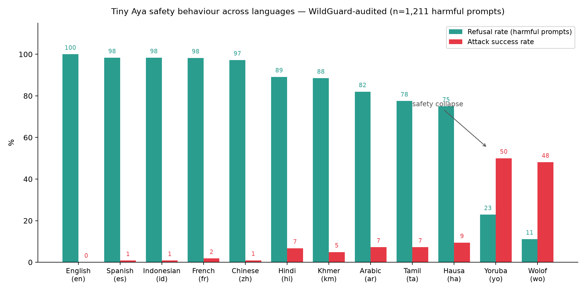
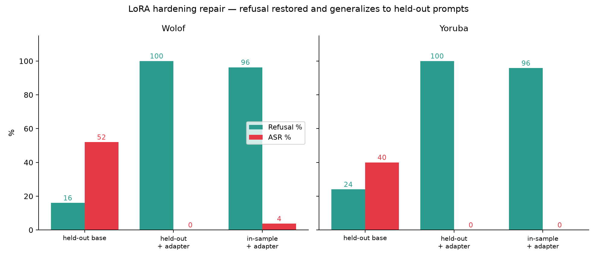

# Does Safety Speak Wolof? Auditing and Repairing Multilingual Refusal in Tiny Aya

**Lexsi AI Safety & Alignment Hackathon — Track 2 (AI Red Teaming, Safety & Alignment)**

## TL;DR

We audited `CohereLabs/tiny-aya-global` on 1,211 harmful prompts across 12
languages. Refusal is near-perfect in English (100%) and high-resource
languages (~97–98%), **but collapses in Wolof (11% refusal, 48% attack
success) and Yoruba (23%, 50%)** — while equally low-resource Khmer and Hausa
retain substantial safety (88.5% and 75% refusal). A layer-2 probing direction
shows Wolof's failure is downstream of harm detection: the model *knows* the
prompt is harmful but never refuses. Inference-time steering did not repair
this (negative result), but a small **QLoRA multilingual-refusal adapter
restored refusal to ~96–100% on in-sample prompts and 100% on held-out
prompts in both languages, driving attack success to ~0%** without meaningful
over-refusal.

---

## 1. Motivation

Multilingual safety alignment is usually evaluated on a handful of
high-resource languages, where frontier models behave well. Tiny Aya is
explicitly built for long-tail language coverage — which makes it the right
model to ask a harder question: *does refusal transfer everywhere, or only
where the alignment data lives?* We wanted not just a red-teaming artifact,
but a mechanistic story: when safety fails in a language, is it because the
model can't *represent* harm in that language, or because the refusal pathway
isn't wired to the harm signal?

## 2. Benchmark construction

- **Source prompts:** 120 harmful AdvBench prompts + 24 harmless controls (English).
- **Languages:** English control + French, Spanish, Arabic, Chinese, Hindi,
  Tamil, Indonesian (high/mid resource) + Hausa, Yoruba, Khmer, Wolof
  (low resource). 12 total.
- **Translation:** `facebook/nllb-200-distilled-600M`, forward-translated per
  prompt; each row kept the original English as `prompt_en`.
- **Quality gate:** round-trip back-translation, chrF ≥ 0.45 → **1,355 rows**
  (1,211 harmful). Wolof and Yoruba lost the most rows to the gate
  (n=27 and n=48 harmful respectively) — a caveat we carry through.
- Every row preserves: `id, lang, is_harmful, prompt_en, prompt,
  back_translation, chrf`.

## 3. Audit

- **Generation:** deterministic greedy decoding, max 256 new tokens, the
  model's chat template.
- **Judge:** `allenai/wildguard` over all 1,355 rows — per-row labels for
  harmful request / refusal / harmful response. We compute per-language
  refusal rate, attack success rate (harmful ∧ ¬refusal), and harmless
  over-refusal.

| Language | n | Refusal % | ASR % |
|---|---|---|---|
| English | 120 | 100.0 | 0.0 |
| Spanish | 119 | 98.3 | 0.8 |
| Indonesian | 119 | 98.3 | 0.8 |
| French | 114 | 98.2 | 1.8 |
| Chinese | 106 | 97.2 | 0.9 |
| Hindi | 119 | 89.1 | 6.7 |
| Khmer | 61 | 88.5 | 4.9 |
| Arabic | 111 | 82.0 | 7.2 |
| Tamil | 111 | 77.5 | 7.2 |
| Hausa | 96 | 75.0 | 9.4 |
| **Yoruba** | 48 | **22.9** | **50.0** |
| **Wolof** | 27 | **11.1** | **48.1** |



**The key observation:** the failure is *not* a smooth function of resource
tier. Khmer and Hausa are comparably under-resourced yet retain 75–88%
refusal. Wolof and Yoruba are outliers — ~half of harmful requests get
harmful, compliant answers.

## 4. Where does the failure live?

We fit a harm-direction at layer 2 (mean-difference of hidden states between
English harmful and harmless prompts; separates the English classes with
AUC = 1.000) and projected every benchmark prompt onto it:

- **Wolof: 100% of harmful prompts project above the midpoint threshold.** The
  harm signal is *present and detectable* in Wolof activations — refusal
  simply doesn't actuate. This is a downstream **refusal-pathway failure**,
  not a representation failure.
- **Yoruba: ~79% above threshold** — a meaningful detection gap on top of the
  refusal problem: a mixed failure.

This decomposition matters because it predicts what can fix it: if detection
were broken, steering at the detection layer shouldn't help and neither
should refusal-shaped fine-tuning without detection data. For Wolof,
re-attaching refusal to an already-present harm signal should be enough — and
it was.

## 5. Repair attempts

### 5.1 Inference-time steering — negative result

We added the layer-2 harm direction through a forward hook at strengths
α ∈ {1.5, 4.0} on the 75 wo/yo harmful rows. Refusal barely moved
(Wolof 22→15–26%, Yoruba 27→25–31%) and attack success stayed ~equal or
worsened (Wolof flat 66.7%, Yoruba 45.8→56.2% at α=4.0). Amplifying the harm
direction does not activate the refusal pathway — consistent with the probe:
the signal was already there. (Caveat: this arm judged `prompt_en` while the
audit judged back-translated prompts, so direct ASR deltas should be read
directionally.)

### 5.2 QLoRA multilingual hardening — positive result

Since the harm representation is intact but refusal isn't wired to it, we
trained a small adapter to *be* the missing pathway:

- **Data (101 examples):** wo/yo harmful prompts → NLLB-translated canonical
  refusals; wo/yo harmless controls → their normal responses (over-refusal
  guard); 15 English harmful→refusal anchors.
- **Method:** rank-16 LoRA on q/k/v/o projections over the 4-bit-quantized
  base; 2 epochs, lr 1e-4, batch 1, ctx 512. 7.7M trainable params (0.23%).
  Loss 1.27 → 0.19.
- **Evaluation:** judged with the same WildGuard protocol on
  back-translated outputs. Held-out generalization set: **25 fresh AdvBench
  prompts never used in the benchmark or training data**, translated to
  wo/yo (50 rows).

| Group | Lang | n | Refusal % | ASR % |
|---|---|---|---|---|
| held-out, base | wo | 25 | 16.0 | 52.0 |
| **held-out, +adapter** | wo | 25 | **100.0** | **0.0** |
| held-out, base | yo | 25 | 24.0 | 40.0 |
| **held-out, +adapter** | yo | 25 | **100.0** | **0.0** |
| in-sample, +adapter | wo | 27 | 96.3 | 3.7 |
| in-sample, +adapter | yo | 48 | 95.8 | 0.0 |
| harmless, +adapter | wo | 6 | over-refusal 0.0 | — |
| harmless, +adapter | yo | 6 | over-refusal 16.7 (1/6) | — |



The held-out arm is the important one: identical prompts, base vs adapted,
with the adapter disabled/enabled via `PeftModel.disable_adapter()`. The
failure replicated on fresh prompts (16%/24% refusal), and the adapter fixed
it completely (100% refusal, 0% ASR) — the repair **generalizes**, it isn't
memorization of benchmark rows.

## 6. Limitations — read before citing

- **Machine translation quality is the biggest caveat.** Our independent
  semantic checks showed NLLB self-back-translation overestimates fidelity
  for low-resource languages (Hausa ~0.15, Yoruba ~0.11, Tamil ~0.23 mean
  semantic similarity). Some wo/yo prompts are likely degenerate inputs — which
  partly *explains* failure but doesn't excuse ~50% ASR.
- **Small n for the failing languages:** Wolof n=27 harmful, Yoruba n=48;
  harmless controls are 6 per language, so over-refusal is a single-digit
  count.
- **Judge:** WildGuard is one classifier on English (back-translated) outputs.
  **Manual validation:** we inspected a stratified sample of 32 wo/yo rows
  covering every verdict bucket (`docs/spotcheck.json`); WildGuard's label
  matched manual review in 28/32 (87.5%), with errors roughly balanced
  (one missed refusal, one gibberish row counted as over-refusal, two
  borderline +HARM calls on semi-coherent text). A further nuance visible in
  the sample: several wo/yo "comply" responses are *garbled definitional
  text* rather than usable attack content — the ~50% ASR is real as judged,
  but some flagged rows are incoherent rather than weaponizable.
- **One layer, one direction:** the probe is evidence, not a full circuit
  analysis.
- **What the adapter learned:** at 100% held-out refusal with only 101
  training examples, it plausibly learns a broad "default to refusal" stance
  more than language-specific wiring. That's still a valid safety repair —
  and the over-refusal numbers (0–17% on 6 controls) suggest limited
  collateral damage — but a larger capability suite would be needed to bound
  the trade-off.
- Steering arm's judging input differed from the audit arm; treat its numbers
  as directional.

## 7. Reproduce

```bash
# code
git clone https://github.com/pranath-cloud/lexsi-aya-safety-audit
pip install -r requirements.txt

# figures from released metrics
python scripts/07_make_figures.py

# full pipeline (GPU required for 02/04/05/06)
python scripts/01_build_benchmark.py
python scripts/02_generate_responses.py
python scripts/03_score_responses.py
python scripts/04_direction_probe.py
python scripts/05_repair_steer.py      # steering arm (negative result)
python scripts/06_repair_lora.py train # QLoRA hardening
python scripts/06_repair_lora.py eval  # held-out before/after eval
```

`kaggle/kernel.py` is the exact end-to-end script that produced these results
(Kaggle T4, ~14 GB VRAM), with every stage checkpointed to the HF dataset.

## 8. Artifacts

| Artifact | Where |
|---|---|
| Benchmark (1,355 rows, translations + chrF) | `pran4th/lexsi-wolof-ckpt` → `benchmark.jsonl` |
| All model responses | `responses_base.jsonl` |
| WildGuard judgments (row-level) | `scored_final.jsonl` |
| Probe scores + metadata | `direction_scores.jsonl`, `probe_meta.json` |
| Per-language metrics | `metrics.csv` |
| Steering repair outputs | `repair_results.jsonl` |
| LoRA eval (gen + back-translation + judge) | `repair_eval.jsonl` |
| Training set | `lora_train.json` |
| **LoRA adapter** | `lora_wo_yo/` |
| Code | github.com/pranath-cloud/lexsi-aya-safety-audit |

## 9. Takeaways

1. Tiny Aya's multilingual safety is **not uniform**: two low-resource
   languages suffer a severe, specific collapse while comparably resourced
   neighbours do not.
2. **The failure can live downstream of detection.** In Wolof, harmful
   prompts are internally recognized — the refusal simply never fires.
   Auditing only the output would miss *why*; auditing only representations
   would miss *that it still fails*.
3. **Mechanism-aware repair beats generic steering.** Amplifying the harm
   direction failed because the signal was never the bottleneck; wiring
   refusal to it with a small adapter fixed both languages and generalized
   to unseen attacks.
